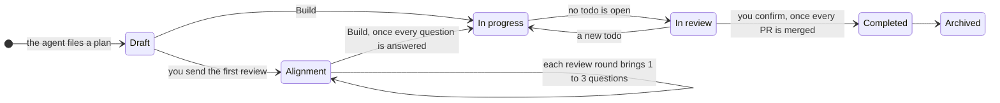
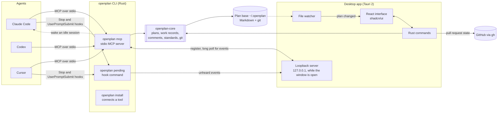
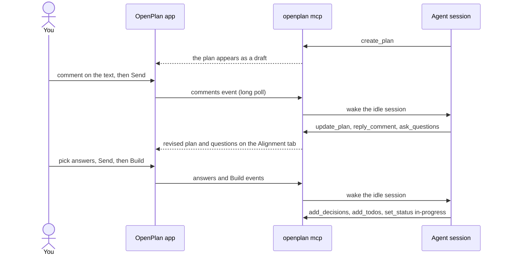

<p align="center">
  <picture>
    <source media="(prefers-color-scheme: dark)" srcset="docs/assets/openplan-logo-dark.svg">
    
  </picture>
</p>

<p align="center">
  
</p>

<p align="center">
  A desktop app that gives every coding-agent plan a lifecycle, with alignment as a
  gate before any code is written.
</p>

Coding agents write good code, but they work from a prompt, a repo and a few context
files. They miss the context a team carries in its head, so they can build a clean
answer to the wrong question. Reviewing the plan an agent wrote rarely catches that,
because the misunderstanding happened before the plan existed.

OpenPlan puts each piece of agent work through fixed states. In the alignment state,
the agent asks you questions until you agree on what to build, why, and how. Only then
does it get a todo list and start. The longer argument is in
[docs/alignment.md](docs/alignment.md).

## How it works

Agents file plans into a local **plan base**: plain Markdown files in a git repository
at `~/.openplan`. They do it through one MCP server, so Claude Code, Codex and Cursor
all use the same tools and the same standards. You read and review plans in the
OpenPlan app, and the agent working on a plan hears your comments and answers while
its session is open.

A plan is the unit of work. One plan can touch several repositories and run across
several agent sessions.

### The plan lifecycle



| State | What happens |
|---|---|
| Draft | The agent writes the first version. You review it with comments on the text. |
| Alignment | Review continues, and the agent asks one to three questions after each round. |
| In progress | You press **Build**. The agent asks anything left, records the decisions, files the todos and starts. A new requirement becomes a todo. |
| In review | No todo is open. The work waits on a person, an agent review or CI. |
| Completed | Every pull request is merged. The app offers "Mark completed", and you confirm. |
| Archived | Put away behind a collapsed group on the board and the list. |

The server checks every move. An agent cannot start work before alignment is recorded
and a todo exists, cannot ask for review while a todo is open, and cannot mark a plan
completed.

### Alignment

- **The agent asks, you decide.** Each question offers at least two options, each with
  what happens if you pick it and what it costs. One option is marked as recommended,
  with the reason, and you pick every answer.
- **Four personas ask.** A product owner, a tech lead, a designer and an on-call
  engineer. The agent picks the ones a plan needs, and the tab names the ones that had
  nothing to ask.
- **Easy questions first.** Early questions confirm scope. Later ones ask you to
  explain your reasoning, where the real gaps tend to show.
- **Error handling, edge cases and scale come first.** They are the things most often
  skipped when working fast. Questions also cover tests, security, user experience,
  performance, design patterns, naming and engineering practice.
- **Answer in the app or in the session.** Questions show as a group chat on the
  plan's Alignment tab, with diagrams, tables or small interactive sketches where a
  question is easier to see than to read. Picking an option is the answer, and one
  Send delivers them all.
- **An alignment score.** Up to 80 points for settling the areas the plan needs, and
  up to 20 for answers that explain why. Build waits until the score reaches a target.
  OpenPlan suggests at least 80, and the target is a setting.

Long plans can carry a short explainer video, rendered with
[Remotion](https://www.remotion.dev), where motion shows a flow faster than text.

## Architecture



- **openplan-core** is a Rust library that owns the file contract: plan frontmatter,
  the work record beside each plan (alignment, decisions, todos, repos, pull
  requests), review comment threads, the standards agents follow, and git history.
  Every write is atomic, and every change is a commit attributed to whoever made it.
- **The openplan CLI** ships inside the app. `openplan mcp` is the MCP server agents
  run. `openplan install <tool>` registers it with Claude Code, Codex or Cursor, and
  adds a short block of instructions to the tool's global instructions file
  (`~/.claude/CLAUDE.md` or `~/.codex/AGENTS.md`). For Claude Code and Cursor it also
  adds the two hooks.
- **The desktop app** is Tauri 2: a Rust process and a React interface in the system
  webview. It watches the plan base and redraws when an agent writes. While its window
  is open it runs a loopback server, so agent sessions can say which plan they are on
  and receive your reviews, answers and Build.
- **Nothing runs in the background.** No daemon, no account, no telemetry. The only
  network calls are the GitHub CLI reading pull request state and the owner avatar
  image for a GitHub repository.

### A review round, end to end



Waking an idle session uses Claude Code's per-session inbox. Where a tool has no
inbox, the hooks deliver the event on your next message, and the app says which
happened.

### MCP tools

| Group | Tools |
|---|---|
| Plans | `get_standards`, `create_plan`, `update_plan`, `list_plans`, `read_plan`, `set_status`, `set_repos` |
| Review | `get_comments`, `reply_comment`, `resolve_comment` |
| Alignment | `ask_questions`, `record_alignment`, `add_decisions` |
| Work | `add_todos`, `update_todo`, `record_pr`, `pr_body` |

## Repository layout

| Path | What it holds |
|---|---|
| `src/` | The React interface: views, plan page, Alignment tab, settings |
| `src/lib/` | Pure logic with tests: scoring, shortcuts, navbar, work records |
| `src/components/ui/` | Vendored shadcn/ui components |
| `src-tauri/src/` | The app's Rust commands, loopback server wiring and pull request reader |
| `src-tauri/crates/openplan-core/` | The file contract, git history, standards and the loopback server |
| `src-tauri/crates/openplan-cli/` | The `openplan` binary: MCP server, installers, hook command, session wake |
| `PLAN.md` | Requirements, architecture, the decision log and the phased backlog |

## Tech stack

| Layer | Choice |
|---|---|
| Desktop shell | [Tauri 2](https://tauri.app), Rust, the system webview |
| Interface | [React 19](https://react.dev), TypeScript, [Vite](https://vite.dev) |
| Design system | [shadcn/ui](https://ui.shadcn.com) on [Radix](https://www.radix-ui.com), [Tailwind CSS 4](https://tailwindcss.com), [lucide](https://lucide.dev) icons, Inter |
| Plan rendering | [react-markdown](https://github.com/remarkjs/react-markdown) with GFM, [Mermaid](https://mermaid.js.org), [KaTeX](https://katex.org), sandboxed HTML |
| Editor | [CodeMirror 6](https://codemirror.net) |
| Storage and history | Markdown and JSON files, [git2](https://github.com/rust-lang/git2-rs) (libgit2, bundled) |
| Agent protocol | [Model Context Protocol](https://modelcontextprotocol.io) over stdio |
| File watching | [notify](https://github.com/notify-rs/notify) |
| Tests | [Vitest](https://vitest.dev), `cargo test` |
| Package manager | [pnpm](https://pnpm.io) |

## Status

0.5.0, in active development. Every state above works end to end with Claude Code. The
app runs on macOS, and CI builds Windows and Linux installers as well. Sync to a git
remote is the next phase. [PLAN.md](PLAN.md) is the source of truth for requirements,
decisions and the backlog, and agents working in this repo start there
(see [CLAUDE.md](CLAUDE.md)).

## Development

Prerequisites: [Node.js](https://nodejs.org) 20 or later, [pnpm](https://pnpm.io),
[Rust](https://rustup.rs) stable, and on Linux the
[Tauri system dependencies](https://tauri.app/start/prerequisites/#linux). The pull
request features need the [GitHub CLI](https://cli.github.com), signed in.

```sh
pnpm install
pnpm tauri dev         # the desktop app with hot reload
pnpm dev               # the interface alone in a browser, with no plans
pnpm test              # TypeScript tests
cargo test --workspace # Rust tests, from src-tauri/
```

A debug build uses its own profile and plan base, `~/.openplan-dev`, so it never
touches the plans of an installed copy.

The app's first run connects your agent tools. To connect one later from a terminal,
run the CLI bundled in the app, shown here for macOS:

```sh
/Applications/OpenPlan.app/Contents/MacOS/openplan install claude-code   # or codex, cursor
```

## Building installers

```sh
pnpm tauri build
```

Bundles land in `src-tauri/target/release/bundle/`: `.app` and `.dmg` on macOS, `.msi`
and `.exe` on Windows, `.deb`, `.rpm` and `.AppImage` on Linux. Pushing a `v*` tag
makes CI build all three and open a draft GitHub release.

The app icons come from `src-tauri/icons/source.svg`:

```sh
pnpm tauri icon src-tauri/icons/source.svg
```

## License

[MIT](LICENSE)
