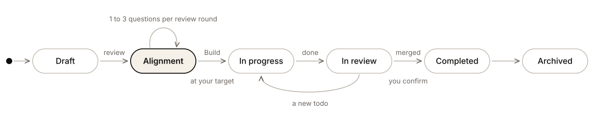

  <picture>
    <source media="(prefers-color-scheme: dark)" srcset="docs/assets/openplan-logo-dark.svg">
    
  </picture>

  
  
  
  
  

  A desktop app that gives every coding-agent plan a lifecycle, 
  with alignment before any code is written.

## Why OpenPlan

Coding agents write good code, but they work from a prompt, a repo and a few context
files. They miss the context a team carries in its head, so they can build a clean
answer to the wrong question. Reviewing the plan an agent wrote rarely catches that,
because the misunderstanding happened before the plan existed.

OpenPlan puts each piece of agent work through fixed states. In the alignment state,
the agent asks you questions until you agree on what to build, why, and how. Only then
does it get a todo list and start. The longer argument is in
[docs/alignment.md](docs/alignment.md).

## How it works

Agents file plans into a local **plan base**: plain Markdown files in a git repository
at `~/.openplan`. Claude Code, Codex and Cursor all reach it through one MCP server,
with the same tools and the same standards. You review plans in the OpenPlan app, and
the agent working on a plan hears your comments and answers while its session is open.

  <picture>
    <source media="(prefers-color-scheme: dark)" srcset="docs/assets/lifecycle-dark.svg">
    
  </picture>

| State | What happens |
|---|---|
| Draft | The agent files the first version. You review it with comments on the text. |
| Alignment | Each review round, the agent revises the plan and asks one to three questions. |
| In progress | You press **Build** once the alignment score reaches your target. The agent records the decisions, files the todos and starts. |
| In review | No todo is open. The work waits on you, a reviewer or CI. |
| Completed | Every pull request is merged, and you confirm. |
| Archived | Put away, by you or after the number of days set in Settings. |

The server checks every move. An agent cannot start work before alignment is recorded
and a todo exists, cannot ask for review while a todo is open, and cannot mark a plan
completed.

## Alignment

- **The agent asks, you decide.** Every question offers at least two options, each with
  what happens and what it costs. One is recommended, with the reason. You pick every
  answer, or write your own.
- **Four personas ask.** A product owner, a tech lead, a designer and an on-call
  engineer, each asking only what the plan needs.
- **Edge cases, error handling and scale, every time.** They are what gets skipped when
  working fast, so every plan settles them.
- **Answer where you are.** Questions show as a group chat on the plan's Alignment tab,
  with diagrams where a question is easier to see than to read. You can also answer in
  the agent's session.
- **A score that only rises.** Up to 80 points for settling the areas the plan needs,
  and up to 20 for answers that say why. Build opens at your target, 80 by default.

## Documentation

| Document | What it covers |
|---|---|
| [Alignment](docs/alignment.md) | Why plans need an alignment step, and how it works |
| [Architecture](docs/architecture.md) | The components, a review round end to end, the MCP tools, the repository layout and the tech stack |
| [Development](docs/development.md) | Running, testing, building installers and releasing |
| [PLAN.md](PLAN.md) | Requirements, decisions and the phased backlog |

## Contributing

OpenPlan does not accept pull requests yet. To report a bug or suggest an idea,
[open an issue](https://github.com/SiddeshSambasivam/openplan/issues/new).

## License

[Apache 2.0](LICENSE)
