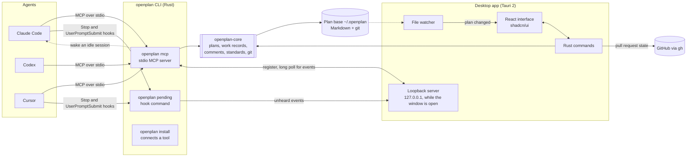
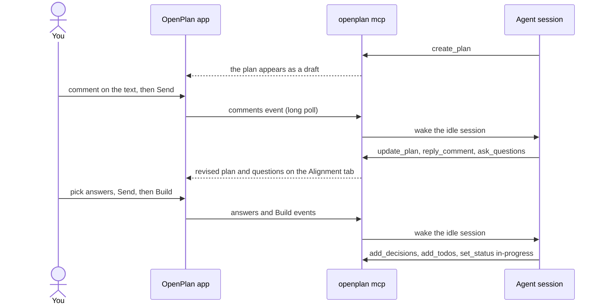

# Architecture

How OpenPlan's parts fit together. The [README](../README.md) covers what OpenPlan is
and the plan lifecycle.

## Components

- **openplan-core** is a Rust library that owns the file contract: plan frontmatter,
  the work record beside each plan (alignment, decisions, todos, repos, pull
  requests), review comment threads, the standards agents follow, and git history.
  Every write is atomic, and every change is a commit attributed to whoever made it.
- **The openplan CLI** ships inside the app. `openplan mcp` is the MCP server agents
  run. `openplan install <tool>` registers it with Claude Code, Codex or Cursor, and
  adds a short block of instructions to the tool's global instructions file
  (`~/.claude/CLAUDE.md` or `~/.codex/AGENTS.md`). For Claude Code and Cursor it also
  adds the two hooks.
- **The desktop app** is Tauri 2: a Rust process and a React interface in the system
  webview. It watches the plan base and redraws when an agent writes. While its window
  is open it runs a loopback server, so agent sessions can say which plan they are on
  and receive your reviews, answers and Build.
- **Nothing runs in the background.** No daemon, no account, no telemetry. The network
  calls are the GitHub CLI reading pull request state, the owner avatar image for a
  GitHub repository, and the update check, which reads one small file.

## A review round, end to end

Waking an idle session uses Claude Code's per-session inbox. Where a tool has no
inbox, the hooks deliver the event on your next message, and the app says which
happened.

## MCP tools

| Group | Tools |
|---|---|
| Plans | `get_standards`, `create_plan`, `update_plan`, `list_plans`, `read_plan`, `set_status`, `set_repos` |
| Review | `get_comments`, `reply_comment`, `resolve_comment` |
| Alignment | `ask_questions`, `record_alignment`, `add_decisions` |
| Work | `add_todos`, `update_todo`, `record_pr`, `pr_body` |

## Repository layout

| Path | What it holds |
|---|---|
| `src/` | The React interface: views, plan page, Alignment tab, settings |
| `src/lib/` | Pure logic with tests: scoring, shortcuts, navbar, work records |
| `src/components/ui/` | Vendored shadcn/ui components |
| `src-tauri/src/` | The app's Rust commands, loopback server wiring and pull request reader |
| `src-tauri/crates/openplan-core/` | The file contract, git history, standards and the loopback server |
| `src-tauri/crates/openplan-cli/` | The `openplan` binary: MCP server, installers, hook command, session wake |
| `PLAN.md` | Requirements, architecture, the decision log and the phased backlog |

## Tech stack

| Layer | Choice |
|---|---|
| Desktop shell | [Tauri 2](https://tauri.app), Rust, the system webview |
| Interface | [React 19](https://react.dev), TypeScript, [Vite](https://vite.dev) |
| Design system | [shadcn/ui](https://ui.shadcn.com) on [Radix](https://www.radix-ui.com), [Tailwind CSS 4](https://tailwindcss.com), [lucide](https://lucide.dev) icons, Inter |
| Plan rendering | [react-markdown](https://github.com/remarkjs/react-markdown) with GFM, [Mermaid](https://mermaid.js.org), [KaTeX](https://katex.org), sandboxed HTML |
| Editor | [CodeMirror 6](https://codemirror.net) |
| Storage and history | Markdown and JSON files, [git2](https://github.com/rust-lang/git2-rs) (libgit2, bundled) |
| Agent protocol | [Model Context Protocol](https://modelcontextprotocol.io) over stdio |
| File watching | [notify](https://github.com/notify-rs/notify) |
| Updates | The Tauri updater, reading its platform's signed manifest, `updates/<os>-<arch>.json`, from S3 behind CloudFront |
| Tests | [Vitest](https://vitest.dev), `cargo test` |
| Package manager | [pnpm](https://pnpm.io) |
