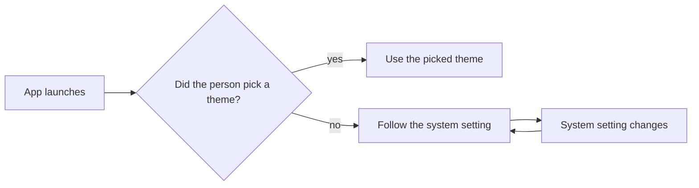

# Demo: add dark mode

## Summary

Notes opens in a white theme only, and people who write at night ask for a dark one. This plan adds a dark theme, follows the system setting by default, and adds a Theme row to Settings so a person can pick light or dark by hand. Every colour pair in both themes passes the contrast check for body text.

## Current state

- `theme/colors.ts` holds 14 colour values, all for the white theme.
- 31 components set a colour directly instead of reading a token, so they would stay white in a dark theme.
- 96 support tickets in the last 90 days ask for dark mode, the most asked for change this quarter.

## Approach

Move every colour into a token, then give each token a light and a dark value. The app reads the system setting on launch and when it changes.

> **Try a comment.** Select this sentence and say whether a new install should follow the system setting or always start light.



Each pair of text and background colours must reach a contrast ratio of 4.5 or more. For two colours with relative luminance $$L_1$$ and $$L_2$$, where $$L_1$$ is the lighter one, the ratio is

$$
\text{contrast} = \frac{L_1 + 0.05}{L_2 + 0.05} \geq 4.5
$$

| Token | Light | Dark | Contrast on its background |
|---|---|---|---|
| `text` | `#1a1a1a` | `#f2f2f2` | 17.4 and 15.5 |
| `text-muted` | `#5c5c5c` | `#a3a3a3` | 6.7 and 6.9 |
| `link` | `#1f5fbf` | `#8ab4f8` | 6.1 and 8.3 |
| `background` | `#ffffff` | `#1a1a1a` | not text |

Press the button to see a note in both themes.

```html
<style>
body{margin:0;font:14px system-ui,sans-serif}
.note{padding:16px;border-radius:8px;background:#ffffff;color:#1a1a1a;border:1px solid #d4d4d4}
.dark .note{background:#1a1a1a;color:#f2f2f2;border-color:#3d3d3d}
button{margin-top:8px;padding:6px 12px;border-radius:6px;border:1px solid currentColor;background:transparent;color:inherit;font:inherit;cursor:pointer}
</style>
<div id="preview">
  <div class="note">
    <b>Groceries</b>
    <p>Oat milk, lemons and coffee.</p>
    <button onclick="document.getElementById('preview').classList.toggle('dark')">Switch theme</button>
  </div>
</div>
```

## Steps

1. Replace the 31 direct colours with tokens in `theme/colors.ts`, with a test that fails on a raw colour value.
2. Add the dark value of each token, with a test that checks every text pair against the contrast ratio.
3. Read the system setting in `theme/useTheme.ts` and follow it when it changes.
4. Add the Theme row to Settings, with light, dark and system.

## Risks and open questions

- Images and pasted screenshots stay as they are, so a white screenshot glares in the dark theme. This plan does not dim images.
- Code blocks use their own colours today. Whether they follow the theme is open.
