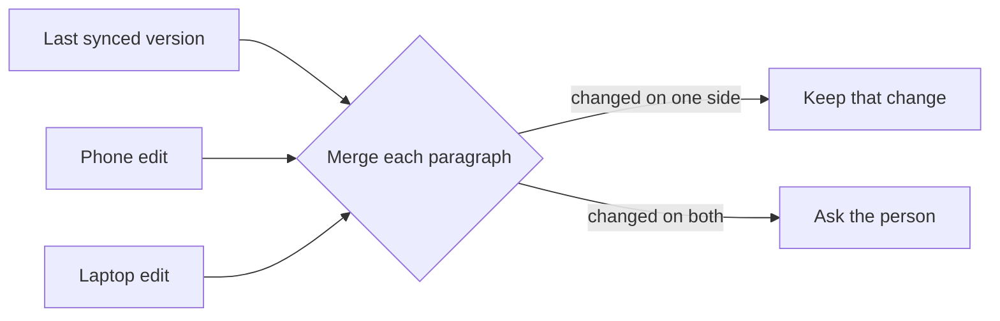

# Demo: sync notes across devices

## Summary

A note edited on two devices while offline keeps only the edit that syncs last. This plan merges the two edits paragraph by paragraph and asks the person about any paragraph both devices changed.

## Current state

- `sync/merge.ts` compares `updatedAt` and keeps the newer note whole.
- 3.1% of syncs last week replaced a note that had been edited on another device.
- 41 support tickets this month mention a lost paragraph.

## Approach

Keep the last synced version of each note. On sync, compare both edits against it, one paragraph at a time. A paragraph changed on one device takes that change. A paragraph changed on both becomes a conflict the person settles in the editor.

## Steps

1. Store the last synced version of each note in `sync/base-store.ts`.
2. Merge paragraph by paragraph in `sync/merge.ts`.
3. Show a conflict in the editor with `editor/ConflictBlock.tsx`.
4. Test two offline edits to the same note, and to different paragraphs of it.

## Risks and open questions

- Each note's last synced version doubles the storage for notes that sync. Notes average 4 KB, so 10,000 notes need 40 MB more.
- A paragraph moved and edited at once reads as a delete and an add. The person sees both and picks one.
